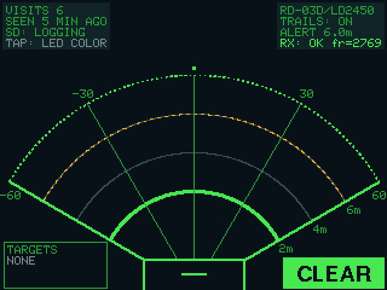
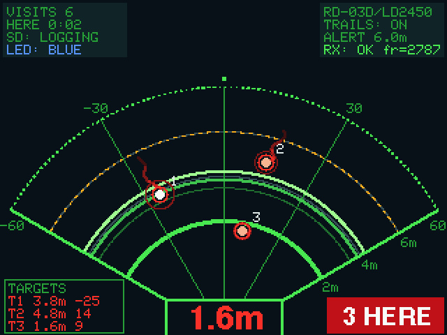
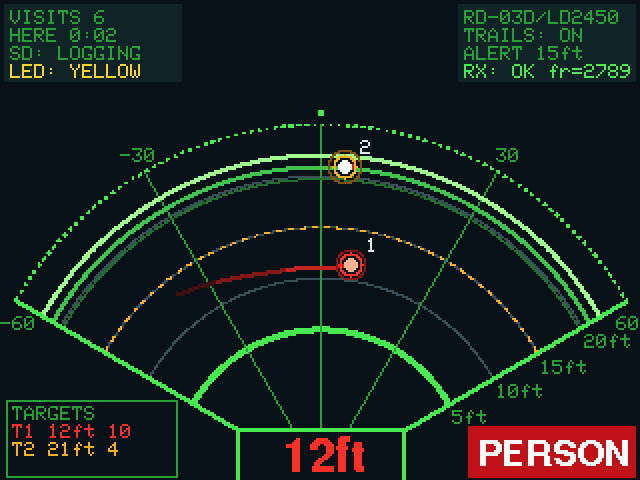
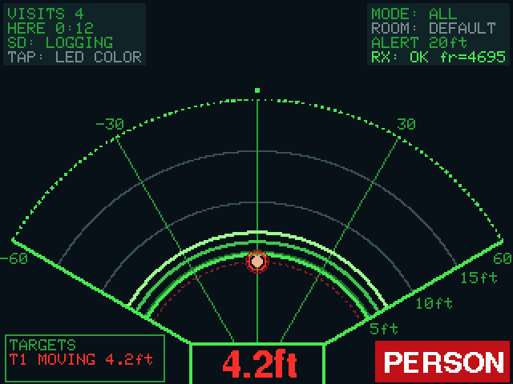
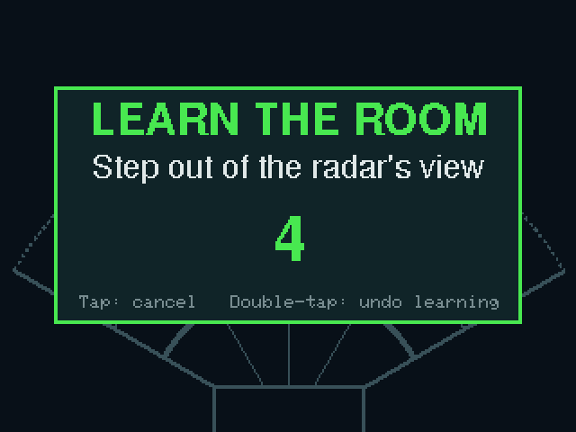
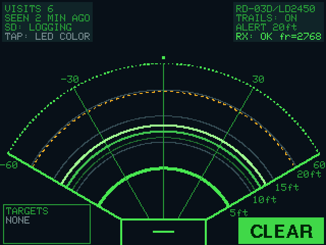
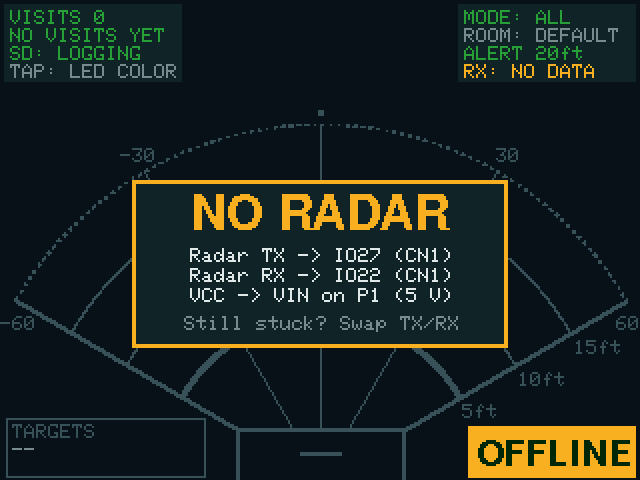

# CYD Human Detector

A standalone person detector built from two cheap parts: the **ESP32-2432S028R "Cheap Yellow Display"** (CYD) and a 24 GHz radar module. The screen looks like a radar scope: a green fan showing what the radar can see, a "ping" that sweeps outward every couple of seconds, and red dots for the people it detects. It can beep when someone arrives (with a speaker), log every visit to an SD card, and light the RGB LED on the back in a color you pick.

It works with two kinds of radar, and works out by itself which one is plugged in:

- **Ai-Thinker RD-03D** or **HLK-LD2450** (recommended): up to **3 people at once**, each shown where they actually are (distance *and* direction), with a short fading trail behind them.
- **HLK-LD2410B**: one person's distance only (it can't tell direction), but it also notices someone sitting or standing perfectly still.



## Screenshots

| **RD-03D: three people** | **RD-03D: one walking across; 15 ft alert distance (amber ring)** |
|---|---|
|  |  |
| **LD2410B: someone walking toward it** | **LD2410B: learn the room** |
|  |  |
| **Nobody in range** | **Radar not connected** |
|  |  |

*Rendered at 2× by the firmware's own drawing code on a PC. Colors on the real panel vary a little between boards. The LD2410B version of the animation is [here](docs/images/radar-ld2410b.gif).*

> **LD2410B: why its dot only moves up and down the middle.** It measures *how far* away someone is, not *which direction*. The dot is placed straight ahead at the right distance, and the faint dotted red arc across the fan means "somewhere along here". The RD-03D and LD2450 report each person's position, so their dots go where the people are.

---

## What you need

| Part | Notes |
|---|---|
| ESP32-2432S028R "Cheap Yellow Display" | Any revision (one or two USB ports) |
| One radar module | **Ai-Thinker RD-03D** (recommended), **HLK-LD2450**, or **HLK-LD2410B** (the LD2410C works too) |
| Cables | **RD-03D:** its socket is a 4-pin **1.25 mm** connector, the same type as the CYD's. Get a pack of 1.25 mm 4-pin cables with bare wire on one end ("pigtails"). **LD2410B:** its pins use the narrow **1.27 mm** spacing, so standard jumper wires won't fit: use 1.27 mm female jumpers, or solder wires on. |
| The CYD's 4-pin cables | The board usually comes with one; you need connections on two of its connectors (P1 and CN1) |
| USB cable + 5 V USB power | A USB power bank works |
| Optional: microSD card | FAT32, up to 32 GB, for the log and settings file |
| Optional: small 8 Ω speaker | On the CYD's 2-pin **SPEAK** connector, for arrival beeps |

## Wiring

All three radars connect the same way: 5 V, ground, and a serial link at 256000 baud.

| Radar pin | CYD connector | CYD pin |
|---|---|---|
| **VCC / 5V** | **P1** (the 4-pin serial connector) | **VIN** (5 V from USB) |
| **GND** | **P1** or **CN1** | **GND** |
| **TX** | **CN1** | **IO27** |
| **RX** | **CN1** | **IO22** |
| OUT (LD2410B) | not used | |

Things to get right:

- **TX goes to IO27 and RX goes to IO22.** That's crossed over on purpose (radar transmit into ESP32 receive). If the screen says **NO RADAR**, swapping these two wires is the first thing to try.
- **Power it from VIN on P1, not from the 3.3 V pin on CN1.** The radars need 5 V. (Their TX/RX signals are 3.3 V, which is right for the ESP32.)
- **RD-03D: check the pin order before you power it.** It differs between modules, and cable wire colors mean nothing. Go by the labels printed on the radar's board or your seller's pinout, not by the order in a photo of someone else's. Then join a pigtail's wires to a P1 cable (5 V, GND) and a CN1 cable (IO27, IO22): solder and heat-shrink, or small lever connectors.

## Flash the firmware

### With PlatformIO (VS Code on Windows)

1. Install [VS Code](https://code.visualstudio.com) and the **PlatformIO IDE** extension.
2. **File > Open Folder…** and pick this folder (the one with `platformio.ini`).
3. Click **✓ Build** in the blue status bar. Everything is pinned to the same versions as the RScan sensor project, so if you've built that, PlatformIO reuses its toolchain. Otherwise the first build downloads it (several hundred MB).
4. Plug in the board and click **→ Upload**. If it stalls at "Connecting…", hold the **BOOT** button on the back until the upload starts.
   The start-up screen shows **"Firmware built …"** with the date and time it was built: check it matches the build you just made. (Opening an older copy of this folder in VS Code uploads the old version.)
5. Optional: open the **Serial Monitor** (plug icon, 115200 baud) to see arrivals, departures and radar messages.

If no COM port shows up, Windows needs the driver for the board's USB chip (CH340 or CP210x, printed next to the USB port).

### Without installing anything

Flash `prebuilt/cyd-human-detector.bin` from Chrome or Edge at [espressif.github.io/esptool-js](https://espressif.github.io/esptool-js/): click **Connect**, pick the board's port, set the flash address to **0x0**, choose the file, and click **Program**.

If you put this folder in a GitHub repo, every push builds the firmware and publishes it at `https://github.com/<you>/<repo>/releases/latest`.

## Using it

| On screen | Meaning |
|---|---|
| **Green fan** | What the radar can see: ±60° to the sides. RD-03D / LD2450: out to 26 ft (8 m), rings every 5 ft (or 2 m). LD2410B: out to 20 ft (6 m), rings every 5 ft (or 1 m). The distances are along the right-hand edge. |
| **Sweeping ping** | Just animation: it shows the radar is connected and running. |
| **Red dots** | RD-03D / LD2450: one per person (up to 3), numbered, where they are, with a fading trail showing where they just walked. LD2410B: one dot, at the person's distance. Amber instead of red when they're beyond your alert distance. |
| **Dashed amber ring** | Your alert distance, when it's shorter than the full range. |
| **Box under the fan** | The nearest person's distance, in big numbers. |
| **TARGETS** (bottom left) | RD-03D / LD2450: one line per person, e.g. **T1 3.8m -25** = person 1, 3.8 m away, 25° to the left (minus = left, plus = right, like the numbers around the fan). LD2410B: a moving target and/or a still one, each with its distance; "STILL: IGNORED" in moving-only mode. |
| **CLEAR / PERSON / 2 HERE** (bottom right) | How many people are within your alert distance. Flashes when someone arrives. |
| Top left | Visits so far, how long the current visitor has been here (or when the last one was seen), SD card status, and the LED's color. |
| Top right | The radar type and **TRAILS** (RD-03D / LD2450), or **MODE** and **ROOM** (LD2410B); the alert distance; and **RX: OK fr=…**, a count of reports received from the radar. It should keep going up. |
| **NO RADAR** | Nothing arriving from the radar: check the wiring. |

| Control | Action |
|---|---|
| Tap the screen | Next color for the LED on the back: off → red → green → blue → yellow → off |
| Double-tap the screen | RD-03D / LD2450: trails on or off. LD2410B: **moving only** mode on or off (see below). |
| Hold the screen ~1 s | Brightness 100% → 50% → 20% |
| Press **BOOT** | Fix the colors if the screen looks inverted (some board revisions) |
| Hold **BOOT** 2 s | LD2410B: **learn the room** (see below) |

All of these are remembered after power-off.

**LED** on the back: off until you pick a color by tapping the screen; it then stays that color. Set its brightness with `led_brightness` in `config.txt`. (It's a plain RGB LED rather than a NeoPixel; yellow is mixed from its red and green, so it can look a little orange or green depending on the board.)

## RD-03D / LD2450 notes

- **Up to 3 people.** The RD-03D can start up tracking just one person, so the board asks it for 3-person tracking every time it connects. (The LD2450 tracks 3 from the start.)
- **It tracks movement.** Things that don't move (metal, furniture, walls) never show up. The flip side: someone who stands completely still can drop off the screen, or their dot can stay where they last moved (`still_targets = off` hides dots that aren't moving).
- **Two people close together** (within about 60 cm, in the same direction) show up as one dot, and dots near the far left and right edges can flicker. A person's number can change when the radar loses and finds them again.
- **People on the wrong side?** It depends on which way up the radar is mounted: set `mirror = on` in `config.txt`.
- **Placement:** on something solid, a bit above waist height and angled slightly down. Hold it still: if the radar moves, everything in front of it looks like it's moving.
- **Learn the room** isn't needed (or available) with these radars.

## LD2410B: metal objects, false detections and accuracy

The LD2410B reports a **moving** target and a **still** target. "Still" detection is how it notices someone sitting or standing motionless (it can pick up breathing), but anything that reflects radar strongly, metal most of all, can also show up as a still target. There are two fixes:

**Moving only** (double-tap the screen). Still targets are ignored completely, so metal, furniture and walls never count. Use this when you hold it in your hand or move it around. The catch: someone standing perfectly still stops counting after a few seconds. Hold the unit steady too: if the radar itself moves, everything in front of it looks like it's moving.

**Learn the room** (hold BOOT for 2 seconds). For a unit that stays in one place:

1. A 5-second countdown: get out of the radar's view (behind it is fine).
2. It measures what the radar sees at each distance for 10 seconds, with nobody there.
3. It raises the radar's trigger level at each distance to just above that (saved in the radar), and also filters on the board. Things that were in view stop counting; a person, who reflects much more than the background at their distance, still does.

If you move the unit, learn again. To undo it, double-tap during the countdown ("undo learning"): that puts the radar back to Hi-Link's factory levels.

**How accurate is the distance?** The radar measures in 0.75 m (2.5 ft) steps and estimates in between, so treat the number as approximate. A moving person's distance is usually steadier than a still one's, so the screen uses the moving distance whenever there is one, and smooths out single odd reports. It also used to show whichever target was nearest, so a metal object closer than you could "win"; it doesn't now.

**Direction:** see the note under the screenshots. The LD2410B can't tell left from right; that needs a different radar.

## SD card (optional)

Put a FAT32 microSD card in before powering on. The board creates a `detector` folder containing:

- **`config.txt`:** settings, each explained inside the file. A copy is in `sd-card/detector/` if you want to prepare a card in advance.

  | Setting | Default | What it does |
  |---|---|---|
  | `units` | `ft` | `ft` or `m` on screen |
  | `alert_distance` | `20 ft` | Someone counts as "here" within this distance. Write it with a unit, e.g. `8 ft` or `2.5 m` (up to 8 m). |
  | `clear_seconds` | `3` | Seconds with nobody in range before it shows CLEAR |
  | `beeps`, `beep_hz` | `2`, `2600` | Beeps when someone arrives (needs a speaker; 0 = silent), and their pitch |
  | `rotation` | `1` | `3` flips the screen upside down |
  | `log` | `on` | Write `log.csv` |
  | `mirror` | `off` | RD-03D / LD2450: swap left and right |
  | `still_targets` | `on` | RD-03D / LD2450: keep showing people who've stopped moving |
  | `led_brightness` | `100` | Brightness of the LED on the back, 0–100 % (tap the screen to pick its color) |
  | `led_invert` | `off` | Set to `on` if the LED is lit when it should be off (a board with the LED wired the other way round) |
  | `sensor_range` | (off) | LD2410B: how far the radar itself looks, 1.5–6 m. Saved inside the radar. |
  | `sensor_hold_seconds` | (off) | LD2410B: how long the radar keeps saying "person" after they leave. Saved inside the radar. |

- **`log.csv`:** one row per arrival and departure: seconds since power-on, `arrived`/`left`, distance (cm) to the nearest person, closest distance (cm), how long they stayed (s), and moving/still. It opens in Excel. The board has no clock, so times are relative to power-on. At 4 MB it's renamed `log-old.csv` and a new one starts.

Restart the board after editing `config.txt`. If a line has a mistake, the start-up screen says how many lines were ignored and the Serial Monitor says why.

## Placement and tuning tips

- **Aim it at the area you care about.** It covers roughly ±60° in front of the side with the printed antenna patterns. Metal in front blocks it; thin plastic, glass and some walls don't, so it can "see" people on the other side of a thin wall.
- **Keep fans, curtains and pets out of view,** or expect occasional false detections.
- **Mount it on something solid** that doesn't vibrate.
- **LD2410B fine-tuning:** it has its own Bluetooth. Hi-Link's **HLKRadarTool** phone app can adjust sensitivity per distance step and shows the same live data. Settings you save there stay in the radar and work with this firmware. Learning the room replaces the per-distance sensitivity.

## Code layout

| File | What it does |
|---|---|
| `src/main.cpp` | Start-up, main loop, arrival beeps, LED, touch and BOOT button |
| `src/radar.cpp` | Serial link to the radar (256000 baud on IO27/IO22); works out which kind is connected |
| `src/tracking_protocol.cpp` | RD-03D / LD2450 frame parser and multi-target command (unit-tested) |
| `src/radar_protocol.cpp` | LD2410 frame parser and command builder (unit-tested) |
| `src/detector.cpp` | Settings file, arrived/left tracking, distance formatting (unit-tested) |
| `src/radar_view.cpp` | The radar screen: fan, ping, dots, trails, boxes and text. Colors are at the top. |
| `src/canvas8.cpp` | The in-memory screen image each frame is drawn into |
| `src/screen.cpp` | Sends each frame to the display (only the rows that changed, ~30 times a second) |
| `src/storage.cpp` | SD card: `config.txt` and `log.csv` |
| `include/pins.h` | Board pins and radar wiring |

**Unit tests** run on your PC (needs a C++ compiler, e.g. MSYS2 g++ on Windows), and on GitHub with every push:

```
g++ -std=c++17 -Iinclude host_tests/host_tests.cpp src/radar_protocol.cpp src/tracking_protocol.cpp src/detector.cpp -o host_tests/run
host_tests/run
```

## Troubleshooting

| Problem | Fix |
|---|---|
| **NO RADAR** on screen | Swap the TX/RX wires. Check VCC goes to VIN on P1 (5 V) and both GNDs are connected. |
| Screen keeps flipping between **NO RADAR** and the radar | The radar keeps going quiet for 3 s or more; the NO RADAR box counts how many times ("Lost 12x"). Wiring order is fine if it works in between, so look for a loose connection (wiggle each wire) or weak power: try another USB cable or charger, since the RD-03D draws short bursts of over 200 mA. The Serial Monitor prints "Radar LOST" / "Radar found" lines and, every 10 s, how many reports arrived and how many were garbled ("bad frames"). |
| RD-03D: only ever one dot, even with several people | The board's command for 3-person tracking didn't get through: check the radar's RX wire (to IO22), then unplug and replug the board. |
| RD-03D: people show up on the wrong side | Set `mirror = on` in `config.txt`. |
| RD-03D: a dot stays put after someone left | The radar kept a track that stopped moving. Set `still_targets = off` in `config.txt` to show only people who are moving. |
| LD2410B: the dot never moves left or right | Expected: the LD2410B only measures distance (see the note under the screenshots). |
| `sensor_range` in config.txt doesn't take effect | The board can hear the radar but can't talk to it: the RX wire (IO22) may be loose. The Serial Monitor shows "Radar range … FAILED". |
| LD2410B: detects metal objects or furniture | Use **moving only** mode (double-tap), or **learn the room** (hold BOOT 2 s) if the unit stays in one place. |
| Detects someone when nobody's there | Something is moving in view (fan, curtain, pet), or it's seeing through a wall. Learn the room with the fan running, re-aim it, or lower `sensor_range`. |
| Learn the room says "DIDN'T WORK" | The board can hear the radar but can't talk to it: check the wire from the radar's RX to IO22. |
| Takes a while to show CLEAR after someone leaves | Lower `clear_seconds`, and `sensor_hold_seconds` (the radar's own hold time, 5 s by default). |
| PlatformIO: `MissingPackageManifestError` | A download got cut off. Close VS Code, delete `platforms`, `packages`, `tools` and `.cache` in `C:\Users\<you>\.platformio` (leave `penv`), reopen and build again. |
| Colors look inverted | Press the **BOOT** button once. |
| The LED is lit when it should be off, and the colors are wrong | Your board's LED is wired the other way round: set `led_invert = on` in `config.txt`. |
